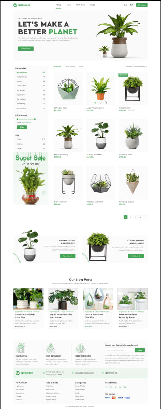
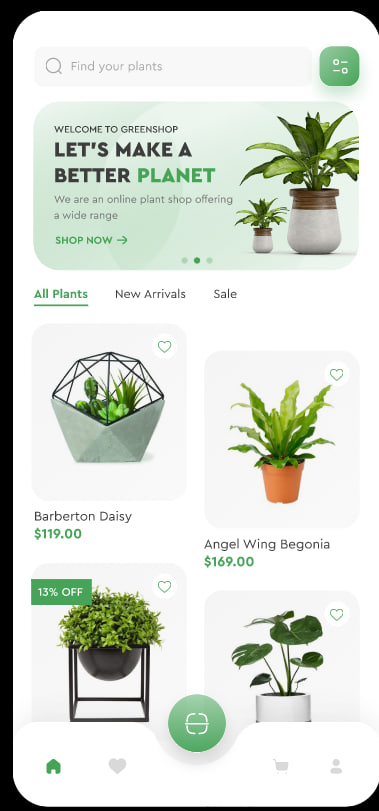
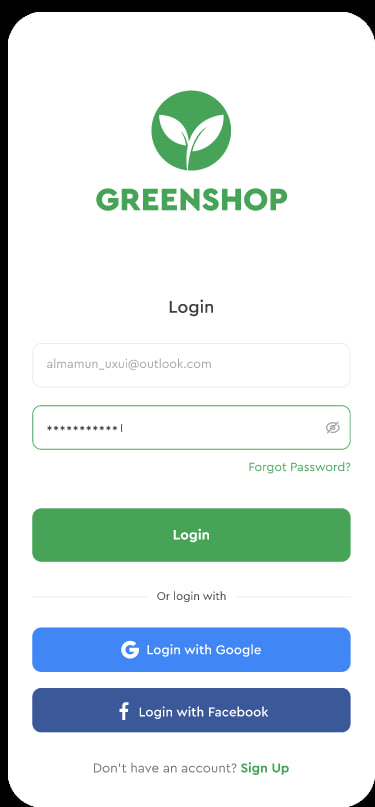
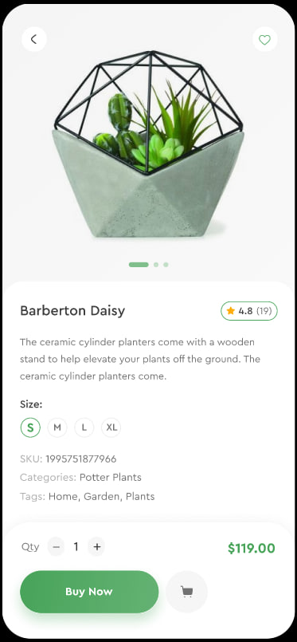

# GreenShop — макет Figma → HTML/CSS

> Багатосторінковий статичний сайт інтернет-магазину рослин, відтворений з макета
> Figma на чистому HTML + CSS (без фреймворків), з окремим мобільним шаром
> під екрани застосунку та повністю робочою навігацією.

**🟢 [Live demo](https://figma-mcp-context-opencode.vercel.app)** ·
**🎨 [Макет у Figma — GreenShop](https://www.figma.com/design/GDInt7mjgpSp3YUE2cgxN0/GreenShop)**

---

## Зміст

- [Що це](#що-це)
- [Бекенд на Django (гілка `dev`)](#бекенд-на-django-гілка-dev)
- [Сторінки](#сторінки)
- [Стек і обмеження](#стек-і-обмеження)
- [Структура проєкту](#структура-проєкту)
- [Як запустити](#як-запустити)
- [Адаптив](#адаптив)
- [Мобільний шар застосунку](#мобільний-шар-застосунку)
- [Збірка сторінок](#збірка-сторінок)
- [Дизайн-токени](#дизайн-токени)
- [Тести](#тести)
- [Перевірки якості](#перевірки-якості)
- [Приватність і секрети](#приватність-і-секрети)

---

## Що це

Верстання десктопного макета GreenShop (фрейм-1–6, 13–15) **плюс** повна заміна
мобільної поведінки під мобільні фрейми застосунку (фрейм-7–12): нижня панель
вкладок із вирізом під плаваючу кнопку, екрани-шапки, сітка карток зі зсувом,
чіпи розмірів, панель покупки, картки кошика й повноекранна авторизація.

Одна головна вимога проєкту — **жодного мертвого посилання**: уся навігація,
діалоги й демо-якорі реально працюють на продакшні.

| | |
|---|---|
| 🖥 Десктоп | 1440 / 1200 контент, 6 брейкпоінтів |
| 📱 Мобільний застосунок | ≤ 640px, окремий шар із 5 CSS-файлів |
| 📄 Сторінок | 9 |
| 🎯 Посилань у мережі | 62 унікальні цілі — усі `200` |

---

## Бекенд на Django (гілка `dev`)

Гілка `main` залишається **чистою версткою** і не чіпається. Уся робота над
магазином іде на гілці `dev`: той самий макет, але серверне рендерення,
адмінка з CRUD і справжня база даних.

**Верстка не переписувалась руками.** `templates/base.html` і паршали
`header` / `footer` / `appbar` вирізано з `index.html` скриптом, а шаблони
сторінок зібрано з `parts/*.html` — класи, розмітка та `aria`-атрибути
збігаються з уже протестованим статичним сайтом.

### Стек

| | |
|---|---|
| Фреймворк | Django 6.1.2 (Python 3.14) |
| База даних | **Neon PostgreSQL 18**, DSN у `backend/.env` → змінна `NEON_DB` |
| Драйвер | psycopg 3.3.6 · Pillow 12.3.0 |
| Статика | власні файли в `backend/static/` + WhiteNoise |
| Оплата | **немає** — замовлення потрапляє в чергу, адмін обробляє вручну |

Три застосунки: `core` (користувачі, адреси, підписники), `catalog`
(категорії-дерево, товари, розміри, відгуки, обране), `orders` (кошик,
замовлення).

### Підняття з нуля

```powershell
cd backend
python -m venv .venv
.\.venv\Scripts\pip install -r requirements.txt

# .env уже лежить поруч із manage.py (не комітиться):
#   NEON_DB=postgresql://...      ← DSN Neon
#   DJANGO_ENV=dev
#   DJANGO_SECRET_KEY=...

.\.venv\Scripts\python.exe manage.py migrate
.\.venv\Scripts\python.exe manage.py createsuperuser   # або seed_demo
.\.venv\Scripts\python.exe manage.py seed_demo         # 208 товарів, 23 категорії
.\.venv\Scripts\python.exe manage.py runserver
```

Без `NEON_DB` проєкт не падає — він переходить на локальний SQLite і друкує
попередження в `stderr`.

### Демо-акаунти

| Роль | Логін | Пароль | Що вміє |
|---|---|---|---|
| Адмін | `admin` | `admin` | `/admin/` — CRUD товарів і категорій, погодження відгуків, обробка замовлень |
| Клієнт | `user` | `user` | кошик, оформлення, історія замовлень, адреси, обране |

### Що працює

- **Каталог** — 208 товарів, 23 категорії (7 коренів + 16 підкатегорій),
  лічильники в сайдбарі рахуються по всьому піддереву, тож збігаються з макетом.
- **ЧПУ (slug)** — генерується з унікальної назви, при колізії додається суфікс.
- **Фільтри й пагінація** — категорія, розмір, тег, ціна, пошук, сортування;
  активні параметри переживають перехід між сторінками.
- **Кошик** — сесійний для анонімів, після входу рядки **зливаються**, а не
  губляться. Залишки перевіряються на рівні моделі, тому кошик не пише в базу
  напряму — лише через `orders/services.py`.
- **Оформлення** — форма запам'ятовує обраний спосіб оплати і на цьому
  зупиняється. Замовлення стає `New`, неоплаченим, з номером `GS-YYMMDD-XXXX`.
  Адмін підтверджує, пакує, відправляє, скасовує або позначає як оплачене.
- **Відгуки** — з модерацією: після погодження перераховується рейтинг товару.
- **Ізоляція** — замовлення, адреси та обране бачить лише їх власник.

### Оновлення бази

```powershell
# нова міграція
.\.venv\Scripts\python.exe manage.py makemigrations
.\.venv\Scripts\python.exe manage.py migrate

# перезібрати демо-каталог (зі 100 товарів → 208)
.\.venv\Scripts\python.exe manage.py seed_demo --wipe
```

> `seed_demo` створює дані через `bulk_create` — рядкові запити до Neon,
> що стоїть в іншому регіоні, вилітають по таймауту.

### Збій, вартий уваги

Шаблонний кеш Django 6.1 (`cached.Loader`) працює **навіть за `DEBUG=True`**.
Створили новий `.html` — перезапустіть `runserver`, інакше отримаєте
`TemplateDoesNotExist` на файл, який уже лежить на диску.

---

## Сторінки

| Файл | Сторінка | Особливості |
|---|---|---|
| `index.html` | Головна, каталог | Герой, фільтри, сітка товарів, промо, блог |
| `product.html` | Картка товару | Галерея, рейтинг, розміри, вкладки, «купити в 1 клік» |
| `cart.html` | Кошик | Таблиця позицій, купон, підсумки, «цікаві товари» |
| `checkout.html` | Оформлення | Форма, типи оплати, підсумок замовлення |
| `order-confirmation.html` | Підтвердження | Діалог успіху з переходами |
| `account.html` | Акаунт | Профіль, замовлення, баланс |
| `address.html` | Адреси | Книга адрес доставки |
| `login.html` | Вхід | Екран авторизації + модальний діалог |
| `register.html` | Реєстрація | Екран реєстрації + модальний діалог |

`login.html` та `register.html` також існують як нативні `<dialog>` на всіх
інших сторінках — кнопка **Login** у шапці відкриває їх без перезавантаження.

---

## Стек і обмеження

- **HTML + CSS**, жодного фреймворка чи збірника на продакшні.
- Один спільний `assets/css/style.css` для десктопа + 5 мобільних CSS-файлів.
- Ванільний `assets/js/main.js` — діалоги, степери, вкладки, мобільна оболонка.
- Інструменти лише для розробки: `live-server`, Playwright, Vercel CLI.

---

## Структура проєкту

```
├── index.html                  ← майстер-шаблон (head, шапка, діалоги, футер)
├── product.html                ← згенеровані з index.html + parts/*.html
├── cart.html
├── checkout.html
├── order-confirmation.html
├── account.html
├── address.html
├── login.html
├── register.html
│
├── parts/                      ← фрагменти <main> для кожної сторінки
│   ├── build.ps1               ← скрипт склейки сторінок
│   ├── product-main.html
│   ├── cart-main.html
│   ├── checkout-main.html
│   ├── account-main.html
│   ├── address-main.html
│   └── thanks-dialog.html
│
├── assets/
│   ├── css/
│   │   ├── style.css           ← десктоп (джерело правди, не чіпається мобільним шаром)
│   │   ├── mobile-shell.css    ← оболонка: таббар, FAB, шапки екранів, пошук
│   │   ├── mobile-home.css     ← герой, фільтри, вкладки, сітка карток
│   │   ├── mobile-pdp.css      ← галерея, аркуш деталей, розміри, панель покупки
│   │   ├── mobile-cart.css     ← картки кошика, підсумки, адреси й оплата
│   │   └── mobile-auth.css     ← повноекранний вхід / реєстрація
│   ├── js/main.js
│   └── images/                 ← растер, SVG-іконки, логотипи
│
├── previews/                   ← 15 експортів макета з Figma (джерело правди)
├── tests/                      ← Playwright: a11y, SEO, перфоманс, скріншоти, Lighthouse
├── sitemap.xml · robots.txt
├── .vercelignore               ← тримає секрети й інструменти за бортом деплою
└── .gitignore                  ← тримає секрети й інструменти за бортом коміту
```

---

## Як запустити

> Статичний сайт із `main`. Для Django-бекенду з `dev` див.
> [Бекенд на Django](#бекенд-на-django-гілка-dev) — він запускається з `backend/`.

```bash
git clone <репо>
cd figma-mcp-context-opencode
npm install

npm run dev        # локальний сервер на http://127.0.0.1:3333
npm test           # Playwright (chromium)
npm run test:ui    # інтерактивний режим Playwright
npm run test:report
npm run deploy     # vercel --prod
```

Для продакшен-деплою потрібен `vercel login` (або `VERCEL_TOKEN`).

### Перезібрати сторінки

`index.html` — майстер. Після зміни шапки/діалогів/футера або `parts/*.html`:

```powershell
powershell -NoProfile -ExecutionPolicy Bypass -File parts\build.ps1
```

Скрипт перепише `product`, `cart`, `checkout`, `account`, `address`,
`order-confirmation`, `login`, `register`.

---

## Адаптив

### Десктопні брейкпоінти (`style.css`)

| Умова | Призначення |
|---|---|
| `max-width: 1180px` | Підтягнення контенту, сітки переходять на меншу кількість колонок |
| `max-width: 1024px` | Компактна шапка, звуження сайдбарів |
| `max-width: 900px` | Стеки замість двох колонок |
| `max-width: 720px` | Таблиця кошика розбирається на картки, футер у колонку |
| `max-width: 520px` | Дрібні корекції типографіки й відступів |
| `prefers-reduced-motion` | Вимикає анімації для користувачів, що просять |

### Мобільний шар (`≤ 640px`)

Працює **поверх** десктопа, не змінюючи його: усі мобільні елементи лежать у
розмітці з `display: none` і «вмикаються» тільки в межах `max-width: 640px`.

---

## Мобільний шар застосунку

| Файл | Відповідає за |
|---|---|
| `mobile-shell.css` | Нижня панель вкладок із вирізом під FAB, кругла кнопка-сканер, шапки екранів (назад / назва / вішліст), рядок пошуку із зеленою кнопкою фільтрів, приховування хлібних крихт |
| `mobile-home.css` | Герой із 2-рядковим описом і текстовим «SHOP NOW →», панель фільтрів, вкладки *All Plants / New Arrivals / Sale*, сітка 2 у ряд зі зсувом, картка зі сердечком у білому крузі, бейдж знижки |
| `mobile-pdp.css` | Повноекранне сіре полотно галереї, білий аркуш деталей із радіусом 30px, чіп рейтингу, круглі чіпи розмірів, панель покупки (`Qty` + ціна, «Buy Now» + кошик) |
| `mobile-cart.css` | Позиції кошика як картки зі ступеневим лічильником, аркуш із купоном і підсумками, картки адрес, картки оплати, список замовлення |
| `mobile-auth.css` | Вхід і реєстрація на весь екран: складений логотип, сині Google/Facebook кнопки, лінки-перемикачі |

Скріншоти макета для звірки лежать у `previews/`:

| Десктоп | Мобільний застосунок |
|---|---|
|  |  |
|  |  |

---

## Збірка сторінок

`parts/build.ps1` склеює сторінки з трьох частин майстра `index.html`:

```
(head + шапка)  +  parts/<page>-main.html  +  (футер + діалоги)
```

Тому будь-яка спільна зміна — новий елемент у шапці, діалозі чи футері —
досить зробити один раз у `index.html`, і вона розповсюдиться на всі 9 сторінок.

---

## Дизайн-токени

Оголошені в `:root` у `style.css`:

```css
--green:      #46a358;              /* бренд, дії, ціни */
--ink:        #3d3d3d;              /* основний текст */
--muted:      #727272;              /* другорядний текст */
--quiet:      #a5a5a5;              /* плейсхолдери */
--surface:    #fbfbfb;              /* фон поверхонь */
--line:       #eaeaea;              /* роздільники */
--radius:     6px;
--container:  1200px;
--gutter:     clamp(16px, 4vw, 24px);
--font:       "Cera Pro", "Poppins", system-ui, ..., sans-serif;
```

Мобільний шар додає власні: `--m-radius: 20px`, `--m-radius-sm: 16px`,
`--m-sheet-radius: 30px`, `--m-surface: #f8f8f8`, `--m-icon: #f4f4f4`,
`--m-google: #4a86f7`, `--m-facebook: #3d5a98`.

---

## Тести

Playwright (`@playwright/test`), TypeScript, браузери Chromium / Firefox / WebKit:

| Спека | Що перевіряє |
|---|---|
| `tests/accessibility.spec.ts` | Доступність: фокус, ARIA, контраст, заголовки |
| `tests/seo.spec.ts` | Мета-теги, `sitemap.xml`, canonical, Open Graph |
| `tests/performance.spec.ts` | TTFB, кеш, стиснення, редіректи, cookie |
| `tests/lighthouse.spec.ts` | Метрики Lighthouse |
| `tests/screenshots.spec.ts` | Регресійні скріншоти на різних в'юпортах |

```bash
npm test                                   # усе
npx playwright test performance --project=chromium
```

---

## Перевірки якості

Останній прогін перед пушем:

- **9 сторінок × 5 в'юпортів** (360 · 390 · 640 · 1024 · 1440) — жодного
  горизонтального переповнення, рівно один `<h1>` на сторінку, чиста консоль.
- **Десктоп недоторканий** — усі мобільні елементи мають розмір `0×0` на 1440px.
- **Краулинг продакшену** — 62 унікальних локальних цілі, усі `200`,
  0 мертвих якорів.
- **`sitemap.xml`** — 9 `<loc>`.
- **Секрети** — `opencode.jsonc`, `spec.md`, `.env`, `.vercelignore`,
  `parts/build.ps1` тощо повертають `404` на продакшні.

### Демо-якорі

Ці посилання навмисно не мають сторінок — їх перехоплює JS і показує підказку
замість переходу на `404`:

`#forgot` · `#google` · `#facebook` · `#coupon-code` · `#wishlist`

---

## Приватність і секрети

`.gitignore` і `.vercelignore` тримають за бортом і комітів, і деплою:

```
opencode.jsonc        ← конфігурація агента, містить ключі
.env / .env.*
.vercel/  node_modules/
spec.md  skills-lock.json  playwright.config.ts  tsconfig.json
tests/  parts/  .agents/  playwright-report/
```

> ⚠️ Ключ API Figma свого часу потрапив у публічно роздаваний `opencode.jsonc`.
> Він більше не розповсюджується, але **його варто відкликати й перевипустити**
> в налаштуваннях Figma.

---

## Ліцензія

ISC — див. `package.json`.
